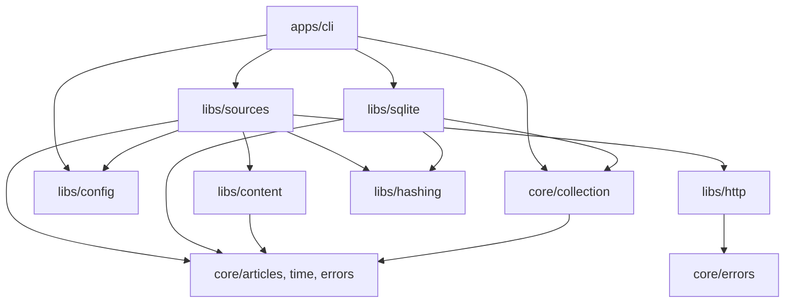

# Inquisitor architecture rework proposal

Status: proposed; implementation has not started. Reviewed 31 October 2026.

The recommendation is to retain the working collection system and reorganize it into a modular application with a technology-independent business core, explicit storage and runtime contracts, and enforceable module APIs. Migrate responsibility by responsibility, keeping each step runnable. A directory move alone would leave the important coupling unchanged.

This proposal applies the [development skill](../.agents/skills/god-emperor-destructor-daddy-of-camel-case/SKILL.md) to the current repository and preserves the approved [project plan](../.agents/memory/ProjectPlan.md). The current implementation is Block 1 article collection; this rework prepares boundaries for later blocks without implementing their undecided behavior.

## 1. Review baseline and limits

The review covered all 19 production TypeScript files (1,510 lines), the eight top-level test files and fixture helper, the three SQL files, configuration, source-development documentation, and implementation tickets.

| Check | Observed result |
| --- | --- |
| `npm.cmd run check` | Passed |
| `npm.cmd test` | 56 passed; zero failed or skipped |
| Compiler configuration | `strict: true`; ESM and NodeNext resolution |
| Architecture/lint/mutation commands | None configured in `package.json` |
| CI workflows | No `.github/workflows` directory found |
| Mutation sensitivity | Not measured; no mutation score claimed |
| Dependency-cycle enforcement | No dedicated checker; acyclicity has not been established automatically |

These are local synthetic/integration checks, not new provider entitlement or completeness verification. No live collection was launched and no production database was changed. `npm` initially selected a PowerShell script blocked by execution policy; the documented Windows `npm.cmd` commands succeeded. Exploratory dependency-graph tooling did not complete, so this review does not claim an automated clean graph.

The reviewed application files are currently untracked in Git. Establish a reviewed source-control checkpoint before implementation; rollback cannot assume those files already exist in a commit.

## 2. What the skill gets right, and how to apply it

The skill's strongest recommendations concern ownership and dependency direction, rather than directory names. Keep its flexibility: small functions can remain together, the Core may orchestrate effects through contracts, and libraries can collaborate through public APIs. Do not turn every helper into an interface or every function into a directory.

| Essential practice | Current assessment | Rework decision |
| --- | --- | --- |
| 1. Modular architecture | Source adapters and shared collection infrastructure already have recognizable responsibilities | Make domain, orchestration, adapters and application composition explicit |
| 2. Explicit dependencies | Transport/clock injection exists; collection still imports storage functions directly | Define narrow effect contracts and compose implementations at the application boundary |
| 3. Independent Core | No explicit core; candidate rules are mixed with HTML conversion and Node utilities | Extract domain/time/collection modules without technical imports |
| 4. Atomic functions | Most files are small; the largest production file is 165 lines | Split along responsibilities, not arbitrary line limits |
| 5. Pure functions | Range, publication, scope and mapping rules are largely deterministic | Separate them from environment reads, HTML libraries, hashing and persistence |
| 6. Dependency injection | `CollectorRuntime` is a useful existing pattern | Extend it to ingestion storage, retry waiting, credentials and wall time |
| 7. Explicit contracts | Shared article/source types and runtime checks exist | Give contracts owners; accept `unknown` at untrusted boundaries and return validated values |
| 8. Targeted JSON Schema | No current Python or cross-language generation requirement | Keep TypeScript authoritative for now; add JSON Schema when a real shared-language consumer exists |
| 9. Public APIs | Files export useful functions, but cross-module internal imports are unrestricted | Add deliberate module entry points and restrict cross-module deep imports |
| 10. Unit tests | 56 tests cover meaningful behavior, adapters and real SQLite | Preserve them, separate test levels, fill specific gaps |
| 11. Mutation tests | No campaign configured | Start with bounded experiments on critical rules |
| 12. Reverse mutation tests | No explicit contract-derived alternative implementations | Exercise the same contract tests against plausible incorrect implementations |
| 13. Architecture controls | Type checking exists; import, cycle and explicit-`any` controls do not | Add verified import/cycle rules and targeted lint checks |
| 14. Module documentation | Strong project/source docs and file comments; few explicit module contracts | Add short module READMEs and update source onboarding alongside the migration |

Two maintenance issues affect discovery today: [AGENTS.md](../AGENTS.md) points to `.skills/...`, whereas the skill lives under `.agents/skills/...`; and the skill references `guide_destructor_daddy.md`, which is absent from the current working tree. During the documentation phase, correct the skill path and either restore the guide from an authoritative copy or make the skill references the maintained source and remove the missing-file prerequisite. Do not fabricate the missing guide.

## 3. Findings that justify the rework

Priorities below reflect implementation/change risk, not a claim of observed production incidents.

### High: business orchestration depends on SQLite

Evidence: [collection.ts](../src/collection.ts), lines 6-7 and 26-28, accepts `DatabaseSync` and calls `hasCoverage`/`insertWindow` directly. Testing the orchestration therefore pulls in SQLite even when only a business decision is under test.

Replace this dependency with a collection-window storage contract owned by the Core. Preserve the existing single transaction for articles plus coverage; separate `articles.save()` and `coverage.save()` calls would weaken correctness.

### High: source-boundary validation swallows every exception

Evidence: [collection.ts](../src/collection.ts), lines 62-69, increments `rejected` for every exception while the collector's own acceptance path only discards `CollectionError("VALIDATION")` ([collector.ts](../src/sources/collector.ts), lines 104-110).

This can hide an unexpected programming error as an invalid article. Extract boundary eligibility into a clear validation function. Propose that only expected validation errors count as item rejects; unexpected errors should fail the window. Because that changes observable error behavior, implement it in a distinct correctness change with regression tests, not invisibly inside a file move.

### Medium: normalization is an accidental shared dependency hub

Evidence: [normalize.ts](../src/normalize.ts), lines 6-7 and 11-160, combines HTML conversion, calendar validation, publication parsing, range filtering, article validation, SHA-256 and fingerprint field selection. Database writes and range validation both load this module, including the HTML dependency.

Separate domain rules from content conversion and cryptographic execution. Retain a single canonical article validator; repeated validation at trust boundaries is defensible, but multiple independently implemented validators would drift. Preserve exactly which fields and serialization order contribute to existing fingerprints.

### Medium: configuration types, file loading and secrets are coupled

Evidence: [config.ts](../src/config.ts), lines 46-54, casts parsed JSON to `Config` and initially checks only presence/enablement; `validateSource` also reads environment credentials. All provider modules import that same loader. [coverage.ts](../src/coverage.ts), lines 22-39, consumes settings before full provider validation.

Separate raw JSON/file access, validated provider settings, selection identity and lazy credential resolution. Validate the settings needed to construct a coverage key before using them. Keep credential resolution inside a real source invocation so covered days still skip successfully when credentials are absent.

### Medium: transport knows a particular provider's payload

Evidence: [http.ts](../src/sources/http.ts), lines 36-43, interprets Marketaux's `usage_limit_reached` body; its `record()` helper returns `Record<string, any>` at lines 68-71.

Keep bounded HTTP reading and common status handling generic. Supply a bounded provider-specific HTTP-error classifier for Marketaux, retaining the 16 KiB cap, safe error codes and non-retryable quota behavior. Replace `any` with `unknown` and explicit field/envelope readers in a separate, behavior-tested slice.

### Medium: dependency injection is incomplete

Evidence: [collection.ts](../src/collection.ts), line 56, sleeps through a real timer; its default reporter writes to console. [sec-edgar.ts](../src/sources/sec-edgar.ts), lines 48 and 64, directly reads `process.env` and `Date.now()`, despite the existing collector runtime. [http.ts](../src/sources/http.ts), line 50, uses wall time for HTTP-date retry calculations.

Distinguish wall time from monotonic time. Inject wall time, monotonic time, waiting, secret lookup and reporting at their actual effect boundaries. Keep production defaults in adapters/facades, with deterministic injected runtimes in most tests.

### Medium: schema ownership will block future block tables

Evidence: [database.ts](../src/database.ts), lines 19-31, compares the complete non-internal database object signature with the known article schemas. Adding a legitimate analysis table would cause the current global verifier to reject that database on reopening.

For the collection refactor, encapsulate and retain this exact verifier. Before Block 2 adds tables, separately design central schema-version/migration ownership and module-specific validation of owned objects. Preserve rejection of incompatible schemas; do not simply relax validation to ignore every unknown object. This is a future compatibility requirement, not a reason to change today's stored data during extraction.

### Medium: unknown failures have an imprecise safe classification

Evidence: [errors.ts](../src/errors.ts), lines 16-18, maps every unknown exception to `DATABASE`, including failures in source code. Redaction is useful and must remain.

First preserve current external error codes during extraction. Then decide whether an internal/unexpected code or boundary-specific fallback is warranted. Any public code change requires explicit contract tests and documentation; do not expose raw exceptions to improve diagnosis.

### Medium: successful tests do not enforce the architecture

Evidence: [package.json](../package.json) provides type checking and tests but no boundary, cycle, mutation or lint commands. Several tests patch globals or import provider internals; positive retry-wait policy is not directly tested with a fake sleep.

Keep adapter-private tests where appropriate, add a small set of public contract suites, and enforce dependency direction separately. Existing coverage and rollback tests are valuable and should survive the rework rather than being replaced with mock-only tests.

## 4. Proposed module structure

Stay with one TypeScript/Node application, one package and the current SQLite database. The following tree describes the end state for existing code. A listed file can stay small; directories correspond to responsibilities, not a requirement for `main.ts` per function.

```text
src/
  core/
    articles/
      index.ts              # Article contracts, validated normalization, fingerprint input definitions
      types.ts
      validate-article.ts
      fingerprint-input.ts
    time/
      index.ts              # Instants, real days, windows and publication-range decisions
      publication.ts
      ranges.ts
    collection/
      index.ts              # Collection use case and its public contracts
      types.ts              # Sources, summaries, coverage identity and storage/runtime ports
      collect.ts
      coverage-policy.ts
      retry-policy.ts
    errors/
      index.ts              # Existing safe error vocabulary/class; no transport implementation
  libs/
    sqlite/
      index.ts              # Open the collection store, backup, restore check
      connection.ts
      schema.ts
      window-store.ts       # Owns atomic article + coverage writes
      backup.ts
    config/
      index.ts              # Read unknown config and environment values; no provider imports
      file-config.ts
      environment.ts
    http/
      index.ts              # Bounded byte/JSON transport and typed error-classifier extension
      request.ts
      lossless-json.ts
    content/
      index.ts              # HTML-to-text conversion and usable candidate selection
      html.ts
      select-content.ts
    hashing/
      index.ts              # Stable SHA-256 execution, exact serialization compatibility
    sources/
      index.ts              # Intentional source factories and range-only public facades
      settings.ts           # Shared operational settings; provider types owned with providers
      registration.ts       # Bind validated selection/config snapshot to coverage identity
      shared/
        collector.ts        # Existing reusable lifecycle, acceptance and invocation state
        budget.ts
        pagination.ts
        readers.ts          # Unknown-valued envelope/field readers; no HTTP dependency
      benzinga/
        index.ts
        collect.ts
        map-article.ts
        settings.ts
      marketaux/
        index.ts
        collect.ts
        map-article.ts
        read-page.ts
        settings.ts
        classify-http-error.ts
      finnhub/
        index.ts
        collect.ts
        map-article.ts
        settings.ts
      sec-edgar/
        index.ts
        collect.ts
        settings.ts
        submissions.ts
        documents.ts        # Keep discovery/extraction together until a real split is useful
  apps/
    cli/
      main.ts               # Process entry point and resource lifetime
      parse-command.ts
      source-registry.ts    # Provider list and selection; composition only
      reporters.ts          # Console JSON formatting and exit-code policy
sql/                        # Keep 001-003 unchanged during the architectural refactor
test/
  unit/
  contracts/
  integration/
  architecture/
  cli/
  helpers/
scripts/                    # Only real checking/generation tasks added during implementation
```

Do not create empty LLM, prices, research, detection, web or worker modules. Introduce them when their contracts and functionality are designed. Keep the PDF dependency lazy as it is today.

## 5. Allowed dependencies and public APIs

Arrows below mean imports, not data flow. Type-only imports also count toward architectural dependencies.



| Module | Allowed direct collaborators | Important forbidden dependencies |
| --- | --- | --- |
| `core/articles` | Core time/errors as needed | HTML/PDF libraries, SQLite, config, HTTP, applications |
| `core/time` | Core errors as needed | Provider configuration, filesystem, network, other application modules |
| `core/collection` | Core articles/time/errors | SQLite driver, provider implementations, console, environment and timers |
| `libs/sqlite` | Core contracts and hashing | Source collectors, application modules |
| `libs/sources` | Core, HTTP, content, hashing, config | SQLite and application modules |
| `libs/http` | Core errors and lossless JSON support | Provider adapters, config loader, database |
| `libs/content` | Core article/content rules and extraction dependencies it actually uses | Database, collection orchestration, applications |
| `libs/config` | Filesystem/environment and Core error vocabulary | Source implementations or their settings types; no reverse dependency |
| `libs/hashing` | Node crypto | Config, source implementations, database, applications |
| `apps/cli` | Public Core/library APIs | Other applications or deep adapter helpers |

Core code may use standard language/platform primitives such as `Date` and `TextEncoder`; exclude concrete Node I/O, driver and third-party technical implementation imports. SHA-256 remains a technical implementation, while the exact fingerprint input fields/order remain a domain contract.

Each module exposes an `index.ts` with intentional named exports. Provider entry points such as `libs/sources/benzinga/index.ts` are explicitly allowed sub-entry points. Consumers must not reach into `shared/`, SQL helpers or provider mappers. Internal imports inside a module remain normal; do not force internal code through its own barrel and introduce cycles. Private implementation tests can have declared access without granting that access to production consumers.

The source facades may read configuration through `libs/config`'s public API, satisfying the approved `collectProvider(range)` behavior. Provider implementation factories accept validated settings and injected effects instead of importing the loader. `libs/config` returns unknown data and environment values; provider-owned decoders supply provider-specific meaning, preventing a config-to-sources-to-config dependency cycle.

CLI composition binds a private settings snapshot to both the source factory and its scope key. Validate dataset selection before calculating the key; resolve secrets lazily inside collection. Do not use one mutable settings object for retrieval and another for coverage.

## 6. Key contracts

The following is proposed interface shape, not implemented code. Initially retain existing article field meanings and safe error vocabulary.

```typescript
interface CoverageIdentity {
  source: string;
  day: string;
  scopeKey: string;
}

interface StoreWindowResult {
  inserted: number;
  alreadyStored: number;
  articleIds: string[];
}

interface CollectionWindowStore {
  hasCoverage(identity: CoverageIdentity): Promise<boolean>;
  commitWindow(input: {
    articles: readonly NormalizedArticle[];
    retrievedAt: string;
    coverage?: CoverageIdentity;
  }): Promise<StoreWindowResult>;
}

interface CollectionRuntime {
  now(): Date; // Wall time: UTC day eligibility and retrieval timestamp
  sleep(milliseconds: number): Promise<void>;
  report(summary: WindowSummary): void;
}

interface CollectionDependencies {
  store: CollectionWindowStore;
  runtime: CollectionRuntime;
}

// Existing SourceFunction remains unchanged:
// (range: PublicationRange) => Promise<NormalizedArticle[]>
```

The SQLite adapter can implement Promise-returning operations around its synchronous driver; this does not make SQLite concurrent or change the sequential collection model. Database handles and transaction controls stay private to the adapter. The CLI owns closing resources in `finally`.

`commitWindow` is the atomic boundary. It validates inputs, generates IDs for new snapshots, computes the existing fingerprints, preserves IDs/content/metadata on conflict, and writes optional coverage in the same transaction. Duplicate inputs retain the current result/count semantics. A no-article success can still commit coverage. A store error rejects the operation.

Keep article normalization deterministic and idempotent for already normalized text. Introduce an `unknown`-accepting decoder at external boundaries rather than casting provider JSON into a trusted model. Preserve runtime metadata validation, the 64 KiB UTF-8 metadata limit, missing-field semantics and the existing English policy. Provider envelope failures remain fatal; invalid discardable individual items remain distinguishable.

The low-level HTTP library exposes bounded response information to a supplied error classifier when needed. It must never leak unbounded provider bodies or secrets into general errors/reporters. Retry classification and delay calculation should be testable independently of real waiting. Monotonic pacing belongs to source runtime; wall time belongs to date/history/HTTP-date decisions.

Keep the bounded SEC metadata cache scoped to the configured source instance, as today, so daily windows can reuse it. Counters, buffers, request pacing and invocation budgets reset per call. Do not accidentally turn the cache into a process-global singleton or erase its cross-window lifetime while moving code.

## 7. Compatibility invariants

These are acceptance requirements for the refactor, drawn from the plan, tickets and existing tests.

1. Preserve command names, arguments, JSON summaries and exit behavior. `--continue-on-error` affects later windows; an independent source still runs after another source fails. Preserve `fetched: null` for a skipped or not-returned fetch.
2. Preserve each provider's range-only public function and normalized-array result. Factories remain available for controlled construction/testing.
3. Preserve half-open precise-time ranges and whole-day-only eligibility for day-precision records. `publishedDate` is the original source day, which can differ from the UTC instant's date.
4. Preserve `(source, provider_article_id)` uniqueness and first-snapshot immutability, including metadata, internal ID, fingerprints and retrieval timestamp.
5. Keep existing content/text fingerprint serialization and SHA-256 output byte-for-byte. Reorganizing files must not invalidate research identity.
6. Keep scope-key serialization byte-for-byte for equivalent current settings; do not invalidate all cached coverage by introducing a different canonicalizer. Preserve SEC selection version fields and existing adapter-version rules.
7. Past full UTC days with zero results may be covered. Current/future/partial days, failed windows and ingestion-boundary rejects must not create coverage. A previously existing coverage record is not deleted by a failed forced refresh.
8. Check coverage before credential access. `--force` bypasses coverage reuse while still preserving first article snapshots.
9. Persist articles and coverage atomically. A failure at either write rolls both back; the network call stays outside the transaction.
10. Preserve per-invocation byte/item budgets, per-stream page guards, initial pacing delays, provider-specific completion rules and no partial-array return after a failed required request.
11. Preserve lossless IDs, Marketaux's quota/error distinctions, Finnhub's summary-only/unknown-completeness semantics, and SEC filing-day/exhibit/document provenance and extraction failures.
12. Preserve compatible schema upgrades, manual consistent backup and restore verification. No data rewrite or fingerprint recomputation is required by the architectural migration.

## 8. File-by-file migration map

| Current file | Proposed owner/action |
| --- | --- |
| `src/types.ts` | Article/metadata types to `core/articles`; ranges to `core/time`; source contracts to `core/collection` |
| `src/errors.ts` | Error vocabulary/class to `core/errors`; boundary-specific safe reporting remains a separate concern |
| `src/normalize.ts` | Split time/article/fingerprint-input rules into Core; HTML into content; SHA-256 into hashing; provider-specific date formats stay with the provider where appropriate |
| `src/coverage.ts` | `pastFullDay` to Core collection/time policy; configured source binding to sources registration |
| `src/collection.ts` | Core collection use case with injected storage/runtime; no SQL, real waiting or console defaults |
| `src/database.ts` | SQLite connection/schema/window store; preserve transaction and schema behavior initially |
| `src/backup.ts` | Private SQLite implementation exposed through SQLite's public API |
| `src/config.ts` | File/environment reading to config; settings/decoders to sources and provider owners; range policy to Core |
| `src/cli.ts` | CLI composition, parsing and reporting under `apps/cli`; optional forwarding entry point during migration |
| `src/sources/collector.ts` | Source shared lifecycle; make effect defaults and acceptance policy explicit |
| `src/sources/http.ts` | Bounded transport to HTTP; budgets and unknown readers to source shared helpers; Marketaux classifier to its provider |
| `src/sources/content.ts` | Content module, depending on its public Core rules |
| `src/sources/pagination.ts` | Source shared page guard; hashing through public API |
| `src/sources/benzinga.ts` | Benzinga retrieval, mapping/settings and public facade |
| `src/sources/marketaux.ts` | Marketaux retrieval, page decoding, mapping/settings, error classification and facade |
| `src/sources/finnhub.ts` | Finnhub retrieval, mapping/settings and facade; shared injected wall clock |
| `src/sources/sec-edgar.ts` | SEC orchestration/settings/facade; retain required-document semantics and cache lifetime |
| `src/sources/sec/submissions.ts` | SEC-owned identity/history/archive path parser |
| `src/sources/sec/documents.ts` | SEC-owned document discovery/extraction; generalize only when another consumer exists |
| `sql/001-003` | Keep paths/content unchanged during extraction; adjust module-relative URLs after moving the loader |
| Existing tests | Rehome by level, retaining fixtures and observable assertions; update test discovery before moving tests |
| README, source docs and tickets | Update public import paths, commands and extension pattern as part of the owning slice |

Use temporary forwarding exports if needed to keep a slice runnable. Give each one an explicit removal phase; permanent old and new APIs would double the supported surface. Do not add path aliases just to resemble the guide: NodeNext-compatible relative imports are sufficient.

## 9. Migration phases and exit criteria

Each phase should be a reviewable checkpoint. Effort is relative to the current small codebase, not a delivery-time promise.

| Phase | Work | Exit criteria | Relative effort/risk |
| --- | --- | --- | --- |
| 0. Freeze the contract | Create a source-control checkpoint; record fixtures for IDs, hashes, scope keys, CLI output and schema versions; repair discovery docs | Current checks pass and a known-good copy is recoverable; fixtures derive meaning from requirements rather than changing the oracle | Small / low |
| 1. Extract pure Core | Split article/time/error/coverage policies from HTML and crypto; add public module APIs | Existing behavior passes; Core imports no technical/application modules; fingerprint/scope fixtures remain exact | Medium / medium |
| 2. Invert storage | Introduce the atomic window-store contract and SQLite implementation; inject storage/runtime into collection | Orchestration tests run with a fake store/clock/sleep; real SQLite rollback, duplicate, coverage and backup tests still pass | Medium / high |
| 3. Separate source effects | Rehome source lifecycle, transport/content helpers and provider settings; retain range-only facades; inject credentials/wall time | Public source contracts pass with fixtures; no source imports SQLite; covered-day skips need no credential; no config/source cycle | Large / medium-high |
| 4. Thin the CLI and organize tests | Separate parsing/wiring/reporting; update npm paths and recursive test discovery; add module docs | Existing CLI scenarios and all relocated tests execute; resources close on failure; no dormant old implementations | Medium / medium |
| 5. Enforce boundaries | Add import/cycle checks, explicit-`any` linting, public-API rules and CI wiring | Allowed/forbidden checker fixtures work; real graph passes; all required commands fail the build on errors | Medium / medium |
| 6. Strengthen behavior and test sensitivity | Make separately reviewed validation/error fixes; run targeted mutation and contract-derived incorrect variants | Correct implementation passes; meaningful wrong alternatives fail for the expected reason; every survivor/invalid run is classified | Medium / bounded high-value changes |
| 7. Complete migration | Remove temporary forwarding APIs; reconcile onboarding/tickets; exercise backup/restore on temporary data | Stable public surface, no stale paths, complete requirement-to-test map and documented remaining gaps | Small / low |

Add the initial boundary checks as soon as the extracted modules exist, then tighten them through phase 5; do not wait until the end to discover illegal dependencies. Keep behavior changes, including the broad catch correction, separate from structural moves.

If a phase fails its exit checks, fix or revert that phase against the reviewed checkpoint before proceeding. Preserve the prior runnable CLI and database compatibility. A backup restore is an explicitly separate operational action; do not overwrite a user database to undo a code refactor.

## 10. Verification design

### Unit and contract tests

Keep the current 56 cases as baseline coverage, reorganizing assertions rather than promising to preserve the numerical count. Extract pure rule suites for timestamps, timezone offsets, precision, half-open bounds, UTF-8 metadata limits, content eligibility, coverage eligibility and retry decisions.

Add a fake-store ingestion suite covering credential-free skips, valid/invalid boundary records, fatal unexpected validation errors, bounded retryable failures, non-retryable failures, `Retry-After`, and independent-source behavior. Use a fake sleeper to assert actual waits without sleeping. Keep whole-window retries at ingestion, rather than adding hidden per-request retry loops.

Define one storage contract suite and run it against the real SQLite adapter, optionally also the fake store to detect a misleading test double. Test failed article and failed coverage writes, duplicate rows within/across calls, stable returned IDs, zero-result coverage and reopening supported historical schemas.

Use existing provider fixtures to preserve completion rules and provenance. Prefer injected transport/credentials/clocks over global patching for implementation tests; retain a few isolated facade/CLI tests proving real config/environment wiring. Include fixed wall-clock SEC cache-day and HTTP-date retry tests.

### Integration and end-to-end checks

Keep real temporary SQLite tests, WAL backup/restore checks and subprocess CLI checks. Add a synthetic end-to-end path from provider-shaped response through mapping, collection and SQL readback, exercising rerun skips and forced immutable snapshots. No live provider is needed for refactor acceptance.

When reorganizing tests, replace `test/*.test.ts` with explicit discovery covering all intended nested directories. Verify the runner's discovered files/cases so a green result cannot mean that moved tests were silently omitted. Include scripts/test helpers in appropriate type-check configuration as they are introduced.

### Architectural checks

Use a checker capable of actual NodeNext import resolution, or a verified parser/resolver implementation, covering `.js` specifiers that resolve to `.ts`, re-exports, declared sub-entry points and aliases if introduced. Count type-only edges for layer rules and a conservative cycle graph; report runtime cycles separately if the tool supports it. Check literal dynamic imports, including the PDF dependency; document unresolved computed imports instead of silently treating them as safe.

Validate the checker with allowed imports, forbidden cross-layer imports, cross-module private imports, legal same-module internal imports, and multi-hop cycles. Ensure the rules enforce both generic layer direction and the stricter collaborator matrix above. Lint explicit `any`; `strict` compilation alone does not ban it. Do not build a regex-only checker and claim complete enforcement.

Proposed commands are `check`, `test`, `lint`, `test:architecture`, and a bounded `test:mutation` workflow. These extra commands do not exist yet. Keep normal local/CI checks fast; run broader mutation campaigns on requested critical changes or a separately configured job. Choose the CI host and verify compatible runtime/tool versions during implementation. Do not enable paid/live integration runs by default.

### Mutation and contract-derived alternatives

Start with four valuable targets rather than mutating the entire tree:

| Target | Plausible incorrect behavior the tests must reject |
| --- | --- |
| Publication filtering | Include the exclusive upper bound; use retrieval time; admit day-only records into intraday ranges |
| Daily coverage | Cover today/partial days; omit source or scope; skip credential resolution only after attempting a fetch |
| Persistence | Update an existing snapshot; commit coverage separately; record coverage after a failed article write |
| Retry and completion | Retry authentication failures; exceed attempts; return a partial array after a required request fails |

Use disposable code/database fixtures. A compile failure or harness crash is not a behavioral kill. Record meaningful kills, survivors, equivalent variants, invalid runs and exclusions. Contract-derived alternatives should come from requirements, not just operator substitutions in the current code. In the guide's terminology this is reverse mutation testing, not a claim of a standardized separate tool.

## 11. Data compatibility and future growth

For phases 0-7, retain SQLite, the existing tables, stored snapshots and current migration behavior. Refactoring must open the same supported databases and produce the same content/text/scope hashes. Use temporary database copies to compare before/after rows; real data is not rewritten as a test step. Check module-relative SQL URLs explicitly after moving `database.ts`.

Before Block 2, design an additive migration registry that can recognize and upgrade the exact currently supported layouts without losing validation rigor. Table ownership should allow each analysis to have its own result table and input/version provenance, while connection/migration coordination remains shared. Whether that needs an explicit schema-version table or SQLite version metadata is a separate design choice.

Later modules should follow the same boundaries:

- Content analysis receives stored article snapshots and injected analysis/storage capabilities. It does not consume prices or future outcomes; analyses retain dedicated versioned results and exact input fingerprints.
- Research receives stored observations/prices and owns pattern definitions and validation evidence. Its feature definitions must be reusable by detection; predictive success is an experimental result.
- Detection receives stored outputs, patterns and shared calculation definitions. Its dependency surface must not provide collector/analysis/retraining launch capabilities. Missing inputs produce readiness findings.

These are extension constraints, not new deliverables for the refactor. Initial analyses, numeric scales, AI provider, statistical thresholds, company/instrument resolution and Block 4 day semantics remain decisions for their detailed designs. Python, PostgreSQL, JSON Schema/type generation and additional services remain conditional proposals.

## 12. Completion definition

The rework is complete when current collection behavior and database compatibility are preserved; the collection use case has no SQLite/environment/console/timer dependency; sources use no database and expose stable APIs; technical implementations can change through their contracts; architecture checks enforce the agreed imports/cycles; all relevant test levels execute; mutation findings are documented for selected critical rules; and the module documentation and agent instructions point to real maintained files.

Recommended implementation start: phases 0-2, with Core extraction and the atomic storage contract reviewed before touching provider retrieval. That is the most direct improvement to dependency direction and test isolation. Continue through sources, composition and enforcement only with the compatibility checks intact at each checkpoint.
